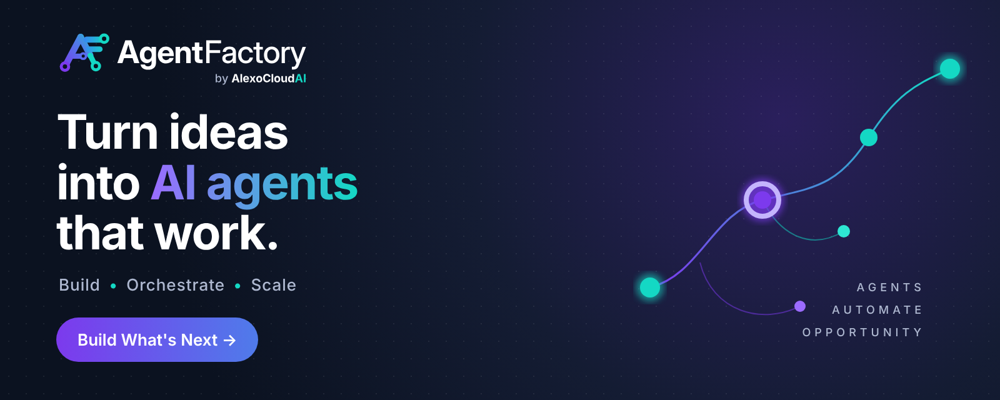

<!-- markdownlint-disable MD030 MD033 MD041 -->

<p align="center">


</p>

<p align="center"><b>AI エージェントを構築・オーケストレーション・スケール</b></p>

<div align="center">

[English](../README.md) | [繁體中文](./README-TW.md) | [简体中文](./README-ZH.md) | [日本語](./README-JA.md) | [한국어](./README-KR.md)

</div>

<a href="https://alexocloudai.com">
</a>

## ⚡ クイックスタート

[Node.js](https://nodejs.org/en/download) 24 と [PNPM](https://pnpm.io/installation) が必要です。

```bash
git clone https://github.com/hiteshb2006/Alexo-Agent-Factory.git
cd Alexo-Agent-Factory
pnpm install
pnpm build
pnpm start
```

ブラウザで開く: [http://localhost:3000](http://localhost:3000)

## 🐳 Docker

1. プロジェクトルートの `docker` フォルダへ移動
2. `.env.example` を `.env` にコピー
3. `docker compose up -d` を実行（初回はソースから `alexocloudai/agentfactory` イメージをビルド）
4. ブラウザで開く: [http://localhost:3000](http://localhost:3000)
5. `docker compose stop` でコンテナを停止

```bash
docker build -f docker/Dockerfile -t alexocloudai/agentfactory .
docker run -d --name agentfactory -p 3000:3000 alexocloudai/agentfactory
```

## 👨‍💻 開発者向け

リポジトリには `server`（バックエンド API と `agentfactory` CLI）、`ui`（React フロントエンド）、`components`（ノードとサードパーティ連携）、`api-documentation`（Swagger ドキュメント）、`agentflow` / `observe`（埋め込み可能な React SDK）が含まれます。開発モード: `packages/ui` と `packages/server` に `.env.example` を元に `.env` を作成し、`pnpm dev` を実行してアクセス: [http://localhost:8080](http://localhost:8080)

## 🌱 環境変数

`packages/server/.env` でインスタンスを設定します。一覧は [CONTRIBUTING.md](../CONTRIBUTING.md) を参照してください。AgentFactory 固有の変数は `AGENTFACTORY_` プレフィックスを使用し、従来の変数名も引き続き利用できます。

## 📖 ドキュメント

[docs.alexocloudai.com](https://docs.alexocloudai.com)

## 🙋 サポート

質問や要望は [GitHub Discussions](https://github.com/hiteshb2006/Alexo-Agent-Factory/discussions) または [support@alexocloudai.com](mailto:support@alexocloudai.com) までお寄せください。

## 📄 ライセンス

本リポジトリのソースコードは [Apache License 2.0](../LICENSE.md) で提供されます（[LICENSE.md](../LICENSE.md) 冒頭に記載のディレクトリを除き、それらは別途商用ライセンスです）。AgentFactory はオープンソースの Flowise プロジェクト（Apache 2.0）を基に構築されており、元の著作権表示は [LICENSE.md](../LICENSE.md) に保持されています。
